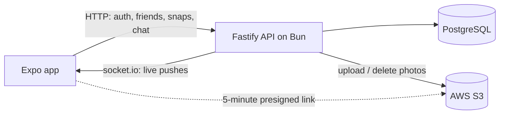
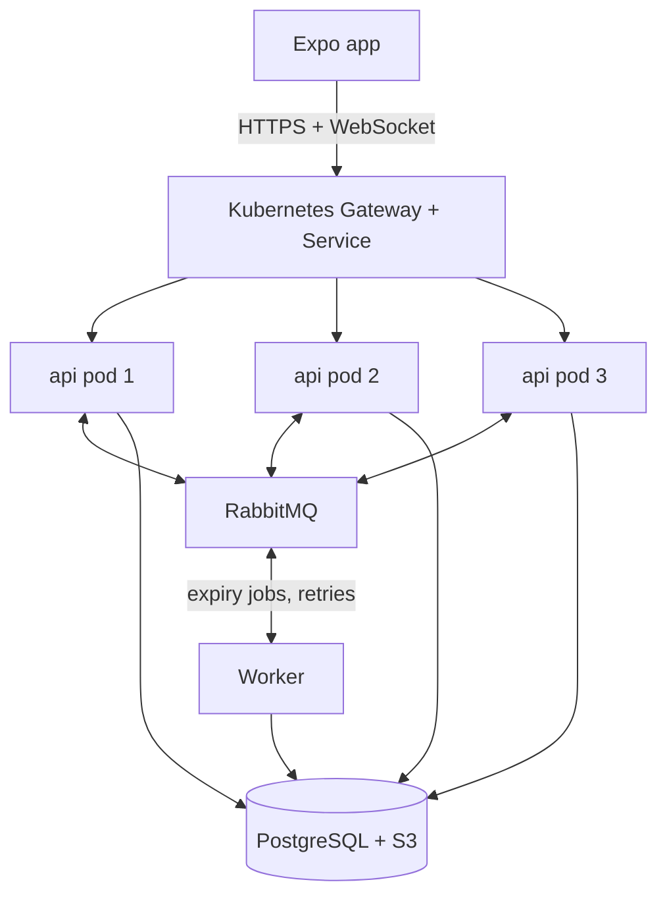
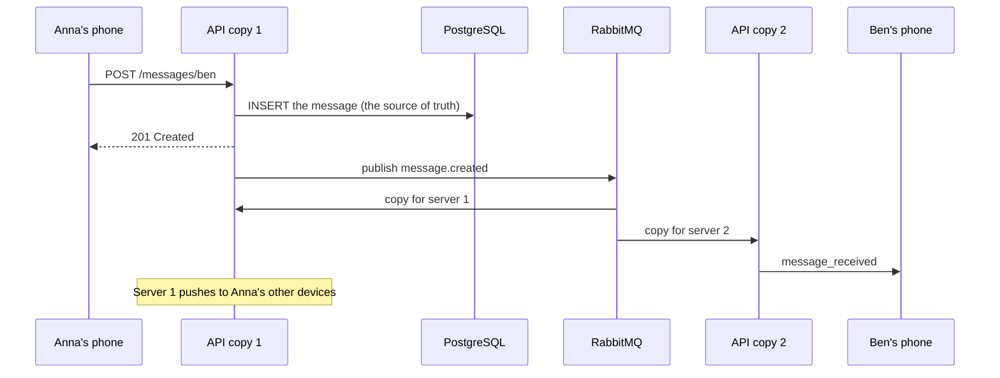
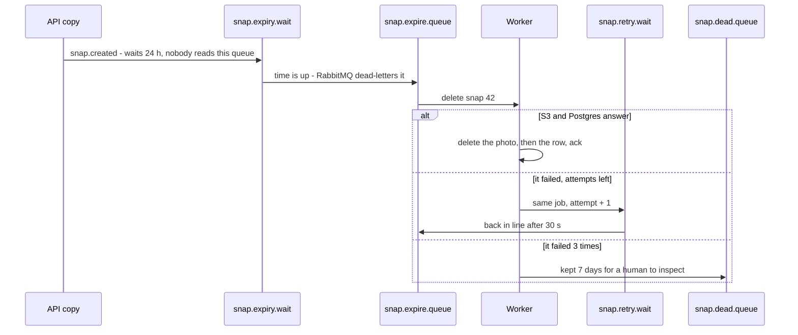

# Snap

A Snapchat-style app: send photo and text snaps that can be viewed once and disappear after
24 hours, chat with friends, and get every update live.

**Expo (React Native) · Bun · Fastify · PostgreSQL · AWS S3 · socket.io** — and, in progress,
**RabbitMQ · Docker · Kubernetes** to run the backend as several copies at once.

> **Status:** the app works end to end on one server. Now it's being scaled out to several
> copies on Kubernetes, with RabbitMQ carrying live events and background jobs between them —
> step by step, each step tested before the next. The full plan and progress are in
> **[SCALING-PLAN.md](SCALING-PLAN.md)**.

## What it does

- **Accounts** — register, log in; short-lived JWT access tokens refreshed automatically.
- **Friends** — add someone, they add you back, you're friends. Snaps only go to friends.
- **Snaps** — a photo, with an optional caption, to one or many friends. It is opened through
  a 5-minute presigned S3 link, and **only once**: the read that authorizes it also marks it viewed.
  The sender is told if you screenshot it. After 24 hours the photo and the row are deleted.
- **Chat** — one-to-one messages with paged history and a conversation list.
- **Live pushes** — new snaps, messages, friend requests and screenshots arrive over a
  WebSocket. The socket only *announces*; all data comes over HTTP, so a missed push is never
  lost data — the app refetches whenever it reconnects.

## Architecture today — one server



This can't simply be copied onto more servers: each user's socket lives in **one** server's
memory, so a message saved by server 1 can't be pushed to someone connected to server 2.

## Where it's going — several copies on Kubernetes



Every api pod is identical and keeps no state of its own. After each write it publishes an
event; RabbitMQ hands a copy to every pod, and whichever one holds the recipient's socket
pushes it. No sticky sessions needed — the app connects over WebSocket only.

Kubernetes runs the pods: it restarts any that die, replaces them one by one on a new version,
and adds pods under load (2–6). It doesn't know which pod holds whose socket — that's
RabbitMQ's job.

### Following one message across servers



### A snap's 24-hour timer



An hourly sweep in the worker deletes anything the timer missed, so a lost or dead-lettered
job never leaves a photo behind.

## Repository

```
backend/          Fastify API on Bun — routes, services, Postgres repository, S3, socket.io
  db/migrations/  SQL migrations (dbmate)
snap/             Expo app (SDK 54, expo-router) — runs in Expo Go
SCALING-PLAN.md   The scaling plan: design, RabbitMQ topology, Kubernetes, steps and progress
```

## Run it locally

You need Bun, Docker, and an S3 bucket with an IAM user that can put, get and delete objects
in it (policy in [`backend/infra/s3-policy.json`](backend/infra/s3-policy.json)).

```bash
docker compose up -d                  # PostgreSQL :5432, RabbitMQ :5672 (web UI :15672)
cd backend
cp .env.example .env                  # DATABASE_URL, RABBITMQ_URL, JWT_SECRET_KEY, S3_*
bun install && bun run migrate
bun run dev                           # http://localhost:3000
bun run e2e                           # in a second terminal: 67 end-to-end checks

cd ../snap
cp .env.example .env                  # EXPO_PUBLIC_API_URL = your computer's LAN address
bun install && bunx expo start        # scan the QR code with Expo Go
```

More detail: [backend/README.md](backend/README.md) (HTTP API, realtime events, snap expiry) and
[snap/README.md](snap/README.md) (app architecture).
